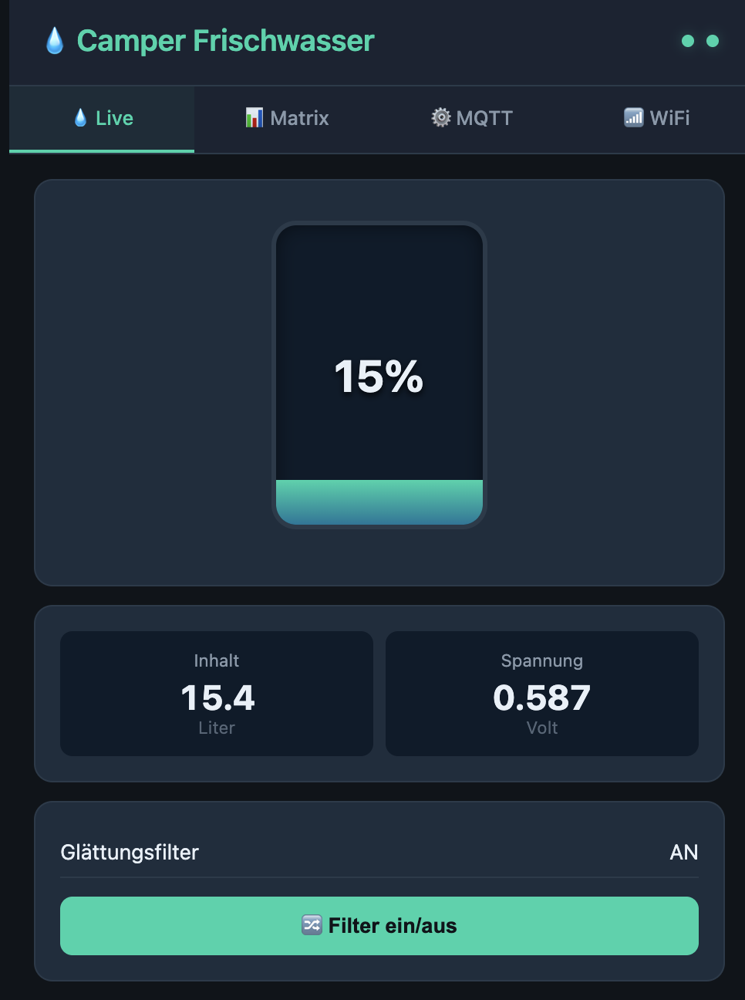
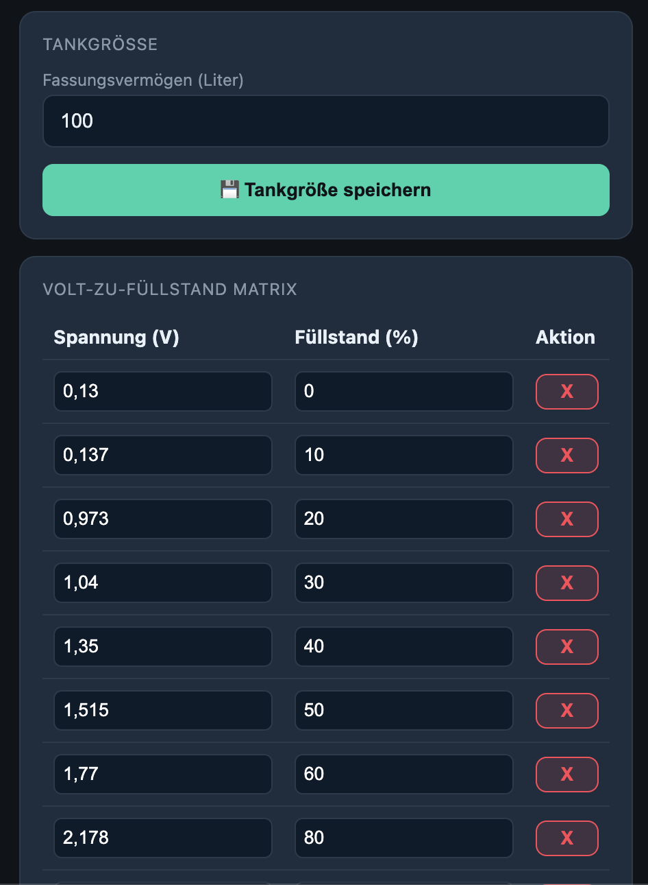

# Camper Waterlevel – ESP32 Frischwasser-Levelsensor

DIY-Frischwassersensor für Wohnmobile und Wohnwagen mit analogem Tankgeber (getestet mit einem Votronic Tankgeber). Ein ESP32 misst die Spannung des Gebers, rechnet sie über eine einstellbare Kennlinie in Füllstand und Liter um und sendet die Werte per MQTT. Home Assistant erkennt die Entitäten automatisch. Alles wird über eine Web-Oberfläche eingestellt, ohne neu zu flashen.



## Arduino IDE oder PlatformIO?

Die Firmware lässt sich auf zwei Wegen bauen. Der Quellcode ist derselbe, du wählst nur das Werkzeug:

| | [**Arduino IDE**](_arduino/README.md) | [**PlatformIO**](_platformio/README.md) |
| --- | --- | --- |
| Für wen | Einsteiger, wer die Arduino IDE schon kennt | Wer mit VS Code arbeitet |
| Board-Einstellungen | von Hand im Menü | stehen fertig in der `platformio.ini` |
| Libraries | von Hand im Bibliotheksverwalter | werden automatisch installiert |
| Web-UI hochladen | über ein Zusatz-Plugin | eingebauter Befehl |
| Anleitung | [**→ _arduino/README.md**](_arduino/README.md) | [**→ _platformio/README.md**](_platformio/README.md) |

Bist du unsicher, nimm die Arduino IDE. Lies vorher aber die Abschnitte [Was du brauchst](#was-du-brauchst), [Welches Board?](#welches-board) und [Verkabelung](#verkabelung) hier unten. Danach geht es mit der jeweiligen Anleitung weiter, und anschließend wieder hier mit der [Ersten Einrichtung](#erste-einrichtung).

## Inhalt

- [Features](#features)
- [Was du brauchst](#was-du-brauchst)
- [Welches Board?](#welches-board)
- [Verkabelung](#verkabelung)
- [Firmware aufspielen](#firmware-aufspielen)
- [Erste Einrichtung](#erste-einrichtung)
- [Kalibrierung](#kalibrierung)
- [MQTT](#mqtt)
- [Home Assistant](#home-assistant)
- [Fehlerbehebung im Betrieb](#fehlerbehebung-im-betrieb)
- [Projektstruktur](#projektstruktur)

## Features

- **Analoge Messung** am ADC-Pin (GPIO0 beim ESP32-C3, GPIO34 beim klassischen ESP32), 8-fach gemittelt pro Messung, mit der werkseitigen Chip-Kalibrierung.
- **Tankgröße einstellbar:** Du gibst das Fassungsvermögen in Litern ein, der ESP berechnet daraus Prozent und Liter.
- **Kalibrier-Matrix im Web-UI:** Bis zu 15 Messpunkte (Spannung → Füllstand in %), Zwischenwerte werden linear interpoliert.
- **Glättungsfilter:** Gleitender Mittelwert über 75 Messwerte (75 s), im Web-UI und per MQTT/Home Assistant ein- und ausschaltbar.
- **WLAN-Einrichtung per Access Point:** Beim ersten Start öffnet der ESP einen eigenen WLAN-Zugang. Dort stellst du WLAN, MQTT und das AP-Passwort ein.
- **MQTT mit Home-Assistant-Discovery:** Messwerte werden retained gesendet, der letzte Stand bleibt also auch bei ausgeschaltetem Sensor erhalten.
- **Live-Web-UI** mit Tankanzeige per WebSocket.
- **OTA-Updates** der Firmware über WLAN.
- **Kein Schlafmodus:** Der ESP bleibt dauerhaft erreichbar und verbindet sich bei WLAN- oder Broker-Ausfall selbst neu.

## Was du brauchst

**Hardware**
- ESP32-Board: **ESP32-C3** (getestet mit ESP32-C3 Super Mini) oder ein **klassisches ESP32-DevKit** (ESP32-WROOM-32), siehe [Welches Board?](#welches-board)
- Analoger Tankgeber, z. B. Votronic
- Stromversorgung 5 V, im Fahrzeug z. B. über einen Buck-Converter 12 V → 5 V, alternativ USB
- USB-**Datenkabel** zum Flashen (ein reines Ladekabel funktioniert nicht)
- Multimeter, um die Signalspannung des Gebers vor dem Anschließen zu prüfen

**Software und Dienste**
- [Arduino IDE 2.x](https://www.arduino.cc/en/software) **oder** [VS Code mit PlatformIO](https://platformio.org/install/ide?install=vscode)
- Ein MQTT-Broker, z. B. das Mosquitto-Add-on in Home Assistant
- Optional Home Assistant mit MQTT-Integration

## Welches Board?

Die Firmware läuft auf zwei Board-Typen. Sie unterscheiden sich im Mess-Pin und in den Einstellungen beim Bauen. **Finde zuerst heraus, welches Board du hast.** Der Typ steht meist auf dem Metalldeckel des Chips oder in der Artikelbeschreibung.

| | ESP32-C3 (z. B. Super Mini) | Klassisches ESP32-DevKit (ESP32-WROOM-32) |
| --- | --- | --- |
| Typisches Aussehen | sehr klein, USB-C, Tasten **BOOT** und **RST** | länger, oft Micro-USB, Tasten **BOOT** und **EN** |
| Mess-Pin (Signal des Tankgebers) | **GPIO0** | **GPIO34** |
| `ADC_PIN` in `config.h` | `0` (Standard) | **`34` (muss geändert werden!)** |
| Arduino IDE: Board | **ESP32C3 Dev Module** | **ESP32 Dev Module** |
| PlatformIO: Umgebung | `esp32c3` (Standard) | `esp32dev` |
| USB-Treiber (Windows) | meist nicht nötig | evtl. CP210x- oder CH340-Treiber nötig |

> ⚠️ **Klassisches ESP32: unbedingt `ADC_PIN` auf `34` ändern.** Beim klassischen ESP32 ist GPIO0 der BOOT-Pin und gehört zum ADC2, der nicht funktioniert, solange WLAN aktiv ist. Mit GPIO0 misst der ESP dort nichts Sinnvolles, und ein angeschlossener Geber kann den Start verhindern. GPIO34 ist ein reiner Eingang am ADC1 und funktioniert mit WLAN. Wo du das änderst, steht in der jeweiligen Anleitung.

## Verkabelung

| ESP32 | Anschluss | Funktion |
| --- | --- | --- |
| GPIO0 (C3) / GPIO34 (klassisches ESP32) | Signal des Tankgebers | Analog-Eingang (Messung) |
| GND | Masse des Tankgebers | Gemeinsame Masse (wichtig) |
| 5V (bei manchen Boards VIN) | 5 V vom Buck-Converter | Versorgung des ESP |
| GND | Masse vom Buck-Converter | Versorgung des ESP |

Beim Flashen am Rechner reicht die Versorgung über USB. Den Tankgeber selbst versorgst du so, wie es der Hersteller vorsieht. Der ESP greift nur die Signalspannung ab. Ohne gemeinsame Masse misst er falsche Werte.

> ⚠️ **Spannung zuerst messen:** Der Eingang des ESP32 verträgt höchstens **3,3 V** und misst zuverlässig nur etwa **0 bis 2,5 V**. Miss die Signalspannung bei vollem Tank mit dem Multimeter, bevor du sie an den Mess-Pin anschließt. Liegt sie höher, brauchst du einen Spannungsteiler (zwei Widerstände) und kalibrierst die Matrix mit den geteilten Werten.

## Firmware aufspielen

Jetzt die Firmware bauen und auf den ESP laden. Folge **einer** der beiden Anleitungen:

- **[Arduino IDE → _arduino/README.md](_arduino/README.md)**
- **[PlatformIO → _platformio/README.md](_platformio/README.md)**

Beide Wege enden gleich: Firmware und Web-Oberfläche sind auf dem ESP, und er öffnet das WLAN `Camper-Waterlevel`. Danach geht es hier weiter.

## Erste Einrichtung

Beim ersten Start kennt der ESP noch kein WLAN und öffnet einen eigenen Zugangspunkt.

1. Verbinde Handy oder Laptop mit dem WLAN **`Camper-Waterlevel`** (Passwort: das `DEFAULT_AP_PASSWORD` aus `config.h`).
2. Öffne im Browser **`http://192.168.4.1`**. Öffnet sich die Seite nicht, schalte am Handy kurz die mobilen Daten ab.
3. Tab **📊 Matrix:** Tankgröße in Litern eintragen und **💾 Tankgröße speichern** drücken. Die Messpunkte passt du später bei der [Kalibrierung](#kalibrierung) an.
4. Tab **⚙️ MQTT:** Adresse deines Brokers, Port (meist `1883`), Benutzer und Passwort eintragen und **💾 Speichern** drücken. Der ESP startet neu, verbinde dich danach wieder mit `Camper-Waterlevel`.
5. Tab **📶 WiFi:** Name (SSID) und Passwort deines WLANs eintragen. Optional Name und Passwort des Access Points ändern. Dann **💾 Speichern & Verbinden**.
6. Der ESP startet neu und verbindet sich mit deinem WLAN. Klappt das nicht, öffnet er nach etwa einer Minute wieder den Access Point, und du kannst die Daten korrigieren.

**Wie finde ich den ESP danach?**
- im Browser unter **`http://camper-waterlevel.local`** (funktioniert in den meisten Netzen),
- in der Geräteliste deines Routers unter dem Namen `camper-waterlevel`,
- oder im Serial Monitor in der Zeile `[WiFi] Connected! IP: …`.

Der Access Point `Camper-Waterlevel` bleibt auch im Betrieb erreichbar (`192.168.4.1`), z. B. wenn das WLAN im Fahrzeug ausfällt.

Gespeicherte Passwörter werden nie an den Browser zurückgesendet. Ein leeres Passwortfeld bedeutet „unverändert lassen“.

## Kalibrierung



Jeder Tank und jeder Geber liefert andere Spannungen. Die Standardwerte in der Matrix stammen von einem 100-L-Tank des Entwicklers und passen bei dir sehr wahrscheinlich nicht. **Ohne eigene Kalibrierung sind die Literwerte ungenau.**

Die Matrix ordnet jeder gemessenen Spannung einen Füllstand in **Prozent** zu. Die Liter berechnet der ESP aus Prozent × Tankgröße, die Matrix bleibt also gültig, wenn du nur die Tankgröße änderst.

So gehst du vor:
1. Im Tab **💧 Live** den Glättungsfilter **ausschalten** (**🔀 Filter ein/aus**). Sonst braucht die Anzeige rund 75 Sekunden, bis sie einem neuen Füllstand folgt.
2. Tank leeren und die angezeigte Spannung notieren. Das ist der Punkt für **0 %**.
3. Tank in bekannten Schritten füllen (z. B. mit einem 10-L-Eimer) und nach jedem Schritt die Spannung notieren. Den Füllstand rechnest du so aus: `Prozent = eingefüllte Liter ÷ Tankgröße × 100`.
4. Zum Schluss die Spannung bei vollem Tank notieren (**100 %**).
5. Im Tab **📊 Matrix** die Punkte eintragen (**+ Punkt hinzufügen**, mit **X** löschen) und **💾 Matrix Speichern** drücken. Die Reihenfolge sortiert der ESP selbst.
6. Den Glättungsfilter wieder **einschalten**.

Mindestens 2 Punkte sind nötig, höchstens 15. Mehr Punkte lohnen sich dort, wo sich die Spannung bei kleinen Füllstandsänderungen stark ändert. Das Limit steht als `MAX_CALIB_POINTS` in `config.h` und in der `data/index.html`.

> Notiere dir deine Messpunkte. Ein erneutes Hochladen der Web-Oberfläche (`data/`) löscht die gespeicherte Matrix.

## MQTT

Standard-Prefix: `camper/waterlevel` (im Web-UI änderbar). Alle Werte werden retained gesendet, alle 5 Sekunden.

| Topic | Richtung | Beschreibung |
| --- | --- | --- |
| `.../voltage` | senden | Gefilterte Spannung in Volt |
| `.../liters` | senden | Tankinhalt in Litern |
| `.../percent` | senden | Füllstand in Prozent |
| `.../rssi` | senden | WLAN-Signalstärke in dBm |
| `.../filter_active` | senden | Zustand des Filters (`ON` / `OFF`) |
| `.../status` | senden | `online` / `offline` (Last Will) |
| `.../cmd/filter/set` | empfangen | Filter schalten (`ON` / `OFF` / `toggle`) |

Zum Testen am Rechner: `mosquitto_sub -h <broker> -u <user> -P <passwort> -t 'camper/waterlevel/#' -v`

## Home Assistant

1. Einen MQTT-Broker einrichten, z. B. unter **Einstellungen → Add-ons → Mosquitto broker**, und einen Benutzer für den ESP anlegen.
2. Unter **Einstellungen → Geräte & Dienste** die Integration **MQTT** hinzufügen, falls sie noch fehlt.
3. In der Web-Oberfläche des ESP (Tab **⚙️ MQTT**) denselben Broker mit Benutzer und Passwort eintragen.
4. Nach dem Neustart erscheint unter **Einstellungen → Geräte & Dienste → MQTT** das Gerät **Camper Wasserlevel Sensor** mit:
   - Frischwasser Inhalt (L), Frischwasser Prozent (%), Tank Spannung (V)
   - WLAN Signal (dBm), Status (online / offline)
   - Schalter Glättungsfilter

Die Füllstand-Sensoren zeigen auch bei ausgeschaltetem ESP den letzten Wert, weil die Werte retained gesendet werden. Damit das auch einen Neustart des Brokers übersteht, muss beim Broker die Persistenz aktiv sein (bei Mosquitto `persistence true`).

## Fehlerbehebung im Betrieb

Probleme beim Bauen und Hochladen stehen in der jeweiligen Anleitung ([Arduino IDE](_arduino/README.md#fehlerbehebung), [PlatformIO](_platformio/README.md#fehlerbehebung)).

**WLAN `Camper-Waterlevel` taucht nicht auf**
Einmal RST/EN drücken und etwa 20 Sekunden warten. Im Serial Monitor nach `[WiFi] AP OK` schauen. Das AP-Passwort in `config.h` muss mindestens 8 Zeichen haben.

**Web-Oberfläche zeigt „Please upload index.html to LittleFS“**
Die Web-Oberfläche (`data/`) wurde nicht hochgeladen. Das ist ein eigener Schritt in beiden Anleitungen.

**Der ESP startet nicht, sobald der Tankgeber angeschlossen ist (klassisches ESP32)**
Der Geber hängt an GPIO0, dem BOOT-Pin. Auf GPIO34 umklemmen und `ADC_PIN` auf `34` setzen, siehe [Welches Board?](#welches-board).

**Spannung zeigt immer 0 oder springt wild (klassisches ESP32)**
Ebenfalls GPIO0 statt GPIO34. GPIO0 liegt dort am ADC2, der bei aktivem WLAN nicht misst.

**Literwerte stimmen nicht**
Die Matrix ist noch nicht auf deinen Tank kalibriert, siehe [Kalibrierung](#kalibrierung).

**ESP verbindet sich nicht mit MQTT**
Adresse, Port, Benutzer und Passwort im Tab **⚙️ MQTT** prüfen. Der Broker muss vom WLAN des ESP aus erreichbar sein. Im Serial Monitor zeigt `[MQTT] Failed, rc=…` den Grund (`rc=4` oder `rc=5` = Benutzer oder Passwort falsch, `rc=-2` = Broker nicht erreichbar).

**Nach einem Update sind alle Einstellungen weg**
Das Hochladen der Web-Oberfläche (`data/`) überschreibt das ganze Dateisystem, also auch WLAN, MQTT, Tankgröße und Matrix. Einfach die [Erste Einrichtung](#erste-einrichtung) wiederholen. Ein reines Firmware-Update behält die Einstellungen.

## Projektstruktur

```
camper-waterlevel/
├── README.md                    – diese Übersicht
├── _arduino/
│   ├── README.md                – Anleitung Arduino IDE
│   └── camper_waterlevel/       – der Quellcode (auch für PlatformIO)
│       ├── camper_waterlevel.ino – Hauptsketch (Setup, Loop, OTA)
│       ├── config.h             – Passwörter, Mess-Pin, Konstanten
│       ├── sensor.h / .cpp      – ADC-Messung, Filter, Interpolation
│       ├── wifi_manager.h / .cpp – WLAN und Access-Point-Fallback
│       ├── mqtt_ha.h / .cpp     – MQTT und Home-Assistant-Discovery
│       ├── webserver.h / .cpp   – Web-Server, REST-API, WebSocket, Konfiguration
│       └── data/index.html      – Web-Oberfläche (LittleFS)
├── _platformio/
│   ├── README.md                – Anleitung PlatformIO
│   └── platformio.ini           – Board, Libraries, OTA; nutzt den Code aus _arduino
└── images/                      – Screenshots
```

Der Quellcode liegt nur einmal im Repo, in `_arduino/camper_waterlevel`. Die PlatformIO-Variante baut genau diesen Code. So sind beide Wege immer auf demselben Stand.

## Danksagung

Die Struktur des Projekts (Web-UI mit Access-Point-Einrichtung, MQTT mit Home-Assistant-Discovery) ist inspiriert von [ESP32-Adrafruit-BNO085-HomeAssistant-Caravan-Levelsensor-MQTT](https://github.com/klehnst/ESP32-Adrafruit-BNO085-HomeAssistant-Caravan-Levelsensor-MQTT) von klehnst. Dieses Projekt misst statt Neigung die Spannung eines analogen Tankgebers.

## Lizenz

MIT, siehe [LICENSE](LICENSE).
